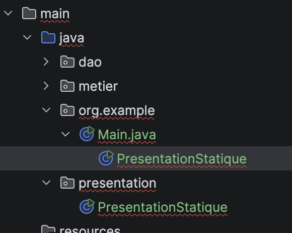
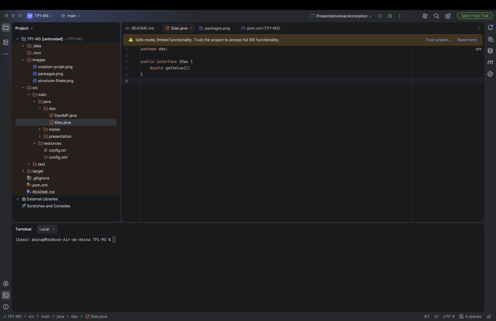
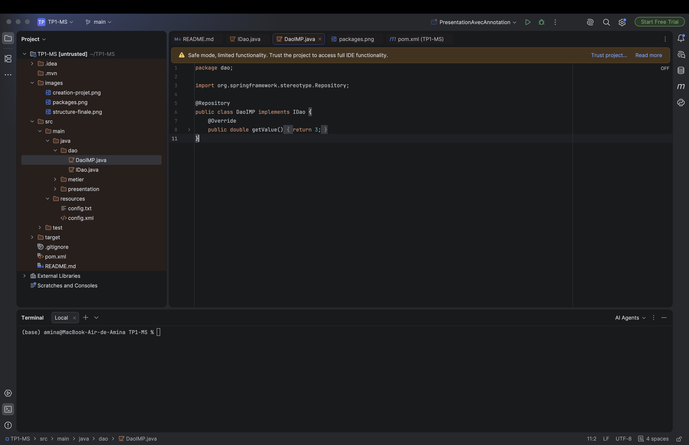
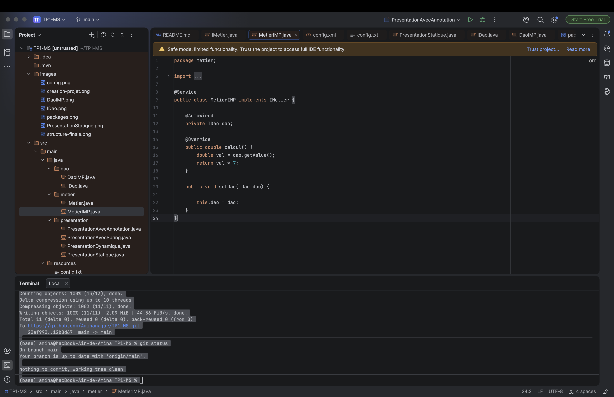
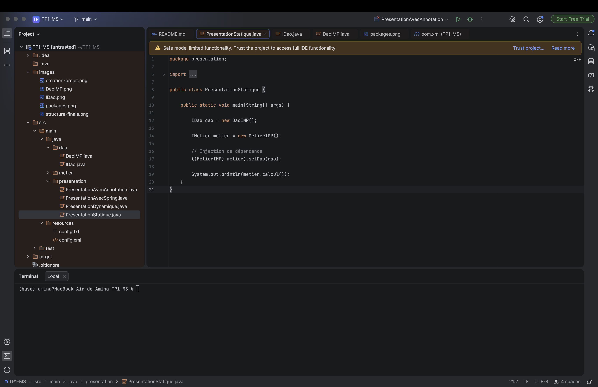
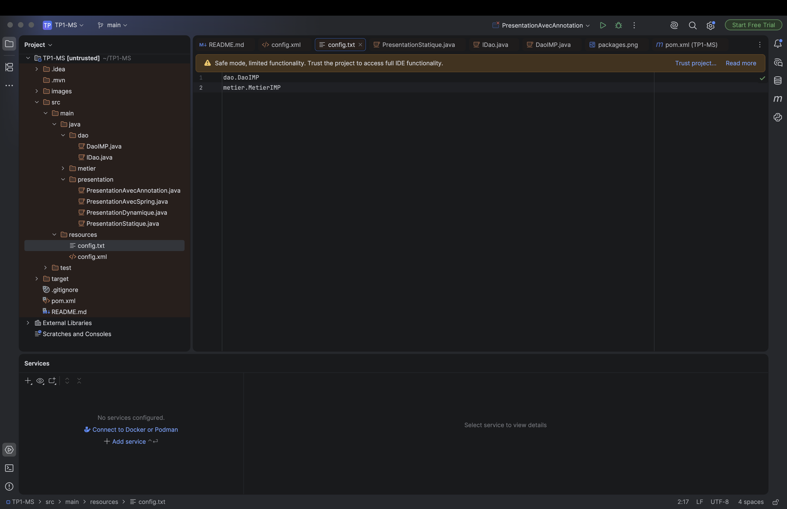
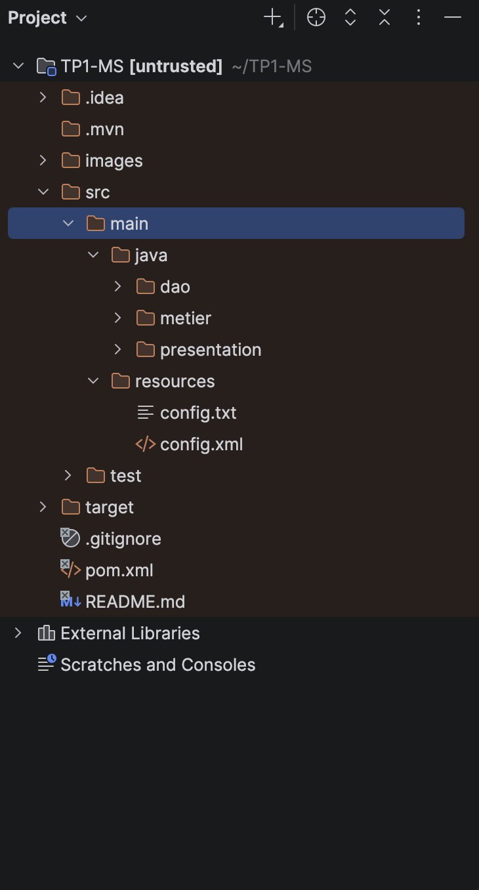

# TP1 : Inversion de Contrôle et Injection de Dépendances

|                         |                                                                                |
|-------------------------|--------------------------------------------------------------------------------|
| **Établissement**       | Faculté des Sciences de Sfax, Département d'informatique et des Communications |
| **Matière**             | Architecture MicroServices                                                     |
| **Filière**             | MPSRCC1                                                                        |
| **Étudiante**           | Amina Najar                                                                    |
| **Année universitaire** | 2026-2027                                                                      |

## 1. Objectif du TP

- Comprendre le principe de l'Inversion de Contrôle (IoC).
- Mettre en œuvre l'Injection de Dépendances (DI) à travers 4 approches :
  1. Injection de dépendances statique.
  2. Injection de dépendances dynamique via un fichier de configuration (`config.txt`) et la réflexion (`Class.forName`).
  3. Injection de dépendances avec Spring XML.
  4. Injection de dépendances avec les annotations Spring.

## 2. Environnement et outils de travail

| Outil            | Version utilisée                                        |
|------------------|---------------------------------------------------------|
| Système          | macOS                                                   |
| JDK              | Eclipse Temurin 17.0.20.1                               |
| IDE              | IntelliJ IDEA 2026.2.3                                  |
| Maven            | Maven intégré à IntelliJ                                |
| Spring Framework | 7.0.8 (`spring-core`, `spring-beans`, `spring-context`) |
| Git              | 2.51.0                                                  |

## 3. Préparation de l'environnement

### 3.1 Création du projet

Le projet a été créé avec IntelliJ IDEA : **File → New → Project**, en choisissant Maven comme système de build.



*Figure 1 : création du projet Maven dans IntelliJ IDEA.*

### 3.2 Création des packages

Trois packages sont créés pour organiser le code :

- **`dao`** : classes liées à l'accès aux données.
- **`metier`** : classes qui réalisent les calculs et la logique métier.
- **`presentation`** : classes qui exécutent l'application et affichent les résultats.

Un dossier **`resources`** est également créé pour stocker les fichiers de configuration.


*Figure 2 : packages `dao`, `metier`, `presentation` et dossier `resources`.*

### 3.3 Ajout des dépendances Spring

Pour les activités 1-3 et 1-4, j'ai ajouté Spring dans le `pom.xml` (modules `spring-core`, `spring-beans` et `spring-context`), puis j'ai rechargé Maven.

```xml
<properties>
    <maven.compiler.source>17</maven.compiler.source>
    <maven.compiler.target>17</maven.compiler.target>
    <project.build.sourceEncoding>UTF-8</project.build.sourceEncoding>
    <spring.version>7.0.8</spring.version>
</properties>

<dependencies>
    <dependency>
        <groupId>org.springframework</groupId>
        <artifactId>spring-core</artifactId>
        <version>${spring.version}</version>
    </dependency>
    <dependency>
        <groupId>org.springframework</groupId>
        <artifactId>spring-beans</artifactId>
        <version>${spring.version}</version>
    </dependency>
    <dependency>
        <groupId>org.springframework</groupId>
        <artifactId>spring-context</artifactId>
        <version>${spring.version}</version>
    </dependency>
</dependencies>
```

## 4. Activité 1-1 : injection par instanciation statique

### 4.1 Couche DAO

Définition de l'interface `IDao`, puis de sa première implémentation `DaoIMP`, qui simule un accès aux données en retournant la valeur 3.



*Figure 3 : l'interface `IDao`.*



*Figure 4 : la classe `DaoIMP`.*

### 4.2 Couche métier

Création de l'interface `IMetier` et de la classe `MetierIMP`. Cette classe utilise un objet de type `IDao`.



*Figure 5 : la classe `MetierIMP`.*

### 4.3 Présentation



*Figure 6 : la classe `PresentationStatique`.*

### 4.4 Exécution

Résultat obtenu : **21.0** (3 × 7), avec `Process finished with exit code 0`.

## 5. Activité 1-2 : injection par instanciation dynamique

### 5.1 Le fichier config.txt



*Figure 7 : le fichier `config.txt`.*

### 5.2 La classe PresentationDynamique

```java
package presentation;

import dao.IDao;
import metier.IMetier;

import java.io.BufferedReader;
import java.io.InputStreamReader;
import java.lang.reflect.Method;

public class PresentationDynamique {
    public static void main(String[] args) throws Exception {

        // 1. Lire config.txt depuis le classpath
        BufferedReader br = new BufferedReader(
                new InputStreamReader(
                        PresentationDynamique.class
                                .getClassLoader()
                                .getResourceAsStream("config.txt")));

        String daoClassName = br.readLine();     // dao.DaoIMP
        String metierClassName = br.readLine();  // metier.MetierIMP
        br.close();

        // 2. Chargement dynamique des classes et création des instances
        Class<?> cDao = Class.forName(daoClassName);
        IDao dao = (IDao) cDao.getDeclaredConstructor().newInstance();

        Class<?> cMetier = Class.forName(metierClassName);
        IMetier metier = (IMetier) cMetier.getDeclaredConstructor().newInstance();

        // 3. Injection par réflexion : appel de setDao(IDao)
        Method setDao = cMetier.getMethod("setDao", IDao.class);
        setDao.invoke(metier, dao);

        // 4. Utilisation
        System.out.println(metier.calcul());
    }
}
```

### 5.3 Exécution

Résultat obtenu : **21.0**, avec `exit code 0`.

## 6. Activité 1-3 : injection avec Spring et un fichier XML

### 6.1 Le fichier config.xml

```xml
<?xml version="1.0" encoding="UTF-8"?>
<beans xmlns="http://www.springframework.org/schema/beans"
       xmlns:xsi="http://www.w3.org/2001/XMLSchema-instance"
       xsi:schemaLocation="http://www.springframework.org/schema/beans
       https://www.springframework.org/schema/beans/spring-beans.xsd">

    <!-- Bean DAO -->
    <bean id="dao" class="dao.DaoIMP"/>

    <!-- Bean métier, avec injection du DAO par le setter setDao() -->
    <bean id="metier" class="metier.MetierIMP">
        <property name="dao" ref="dao"/>
    </bean>
</beans>
```

### 6.2 La classe PresentationAvecSpring

```java
package presentation;

import metier.IMetier;
import org.springframework.context.ApplicationContext;
import org.springframework.context.support.ClassPathXmlApplicationContext;

public class PresentationAvecSpring {
    public static void main(String[] args) {
        ApplicationContext context =
                new ClassPathXmlApplicationContext("config.xml");

        IMetier metier = context.getBean("metier", IMetier.class);
        System.out.println(metier.calcul());
    }
}
```

### 6.3 Exécution

Résultat obtenu : **21.0**, avec `exit code 0`.

## 7. Activité 1-4 : injection avec Spring et des annotations

### 7.1 Les classes annotées

**`dao/DaoIMP.java`**

```java
package dao;

import org.springframework.stereotype.Repository;

@Repository
public class DaoIMP implements IDao {
    @Override
    public double getValue() {
        return 3;
    }
}
```

**`metier/MetierIMP.java`**

```java
package metier;

import dao.IDao;
import org.springframework.beans.factory.annotation.Autowired;
import org.springframework.stereotype.Service;

@Service
public class MetierIMP implements IMetier {

    @Autowired
    private IDao dao;

    @Override
    public double calcul() {
        return dao.getValue() * 7;
    }

    // Conservé pour que les activités 1-1 à 1-3 continuent de fonctionner
    public void setDao(IDao dao) {
        this.dao = dao;
    }
}
```

### 7.2 La classe PresentationAvecAnnotation

```java
package presentation;

import metier.IMetier;
import org.springframework.context.ApplicationContext;
import org.springframework.context.annotation.AnnotationConfigApplicationContext;

public class PresentationAvecAnnotation {
    public static void main(String[] args) {
        // Scan des packages contenant les classes annotées
        ApplicationContext context =
                new AnnotationConfigApplicationContext("dao", "metier");

        IMetier metier = context.getBean(IMetier.class);
        System.out.println(metier.calcul());
    }
}
```

### 7.3 Exécution

Résultat obtenu : **21.0**, avec `exit code 0`.

## 8. Structure finale du projet

```
TP1
├── pom.xml
├── images/
└── src/main
    ├── java
    │   ├── dao
    │   │   ├── IDao.java
    │   │   └── DaoIMP.java
    │   ├── metier
    │   │   ├── IMetier.java
    │   │   └── MetierIMP.java
    │   └── presentation
    │       ├── PresentationStatique.java
    │       ├── PresentationDynamique.java
    │       ├── PresentationAvecSpring.java
    │       └── PresentationAvecAnnotation.java
    └── resources
        ├── config.txt
        └── config.xml
```



*Figure 8 : arborescence finale du projet dans IntelliJ.*
## 9. Synthèse des approches

| Critère | 1-1 Statique | 1-2 Dynamique (réflexion) | 1-3 Spring XML | 1-4 Spring annotations |
|---|---|---|---|---|
| **Classe de présentation** | `PresentationStatique` | `PresentationDynamique` | `PresentationAvecSpring` | `PresentationAvecAnnotation` |
| **Création des objets** | `new DaoIMP()`, `new MetierIMP()` dans le code | `Class.forName()` + `newInstance()` | Conteneur Spring (`ClassPathXmlApplicationContext`) | Conteneur Spring (`AnnotationConfigApplicationContext`) |
| **Injection du DAO** | Appel direct de `setDao()` | `setDao()` appelé par réflexion (`Method.invoke`) | Balise `<property name="dao" ref="dao"/>` | `@Autowired` sur l'attribut `dao` |
| **Où est choisie l'implémentation ?** | Dans le code source | Dans `config.txt` | Dans `config.xml` | Dans les annotations (`@Repository`, `@Service`) et les packages scannés |
| **Modifier l'implémentation sans recompiler** | Non | Oui (modifier `config.txt`) | Oui (modifier `config.xml`) | Non (changer l'annotation ou le package scanné) |
| **Couplage** | Fort | Faible | Faible | Faible |
| **Dépendance à Spring** | Aucune | Aucune | Oui | Oui |
| **Quantité de code / configuration** | Faible, mais rigide | Plus de code (lecture du fichier, réflexion) | Fichier XML à maintenir | Minimale, configuration dans le code |
| **Résultat obtenu** | 21.0 | 21.0 | 21.0 | 21.0 |

**Conclusion du tableau :** les quatre approches donnent le même résultat (3 × 7 = 21.0), mais elles diffèrent par le degré de couplage et par l'endroit où l'on décide quelle implémentation utiliser. L'instanciation statique est la plus simple mais la plus rigide. La version dynamique et Spring XML externalisent la configuration. Les annotations Spring sont les plus concises, au prix d'une configuration intégrée au code.